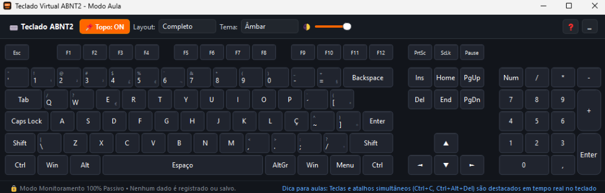

# ⌨ TeclaNaTela - Teclado Didático ABNT2 (Virtual & Interativo)



Aplicação desktop nativa para Windows desenvolvida especialmente para **professores e educadores de Computação/Informática**. Permite demonstrar visualmente em tempo real as teclas e atalhos físicos pressionados durante aulas ao vivo, projeções em datashow ou compartilhamento de tela.

---

## 🎯 Principais Funcionalidades

1. **Layout Completo ABNT2 (Padrão Brasileiro):**
   - Contém a tecla **Ç**, acentos (**´ `**, **~ ^**), **AltGr**, tecla **/ ? °**, barra invertida **\ |** e pontuações do padrão brasileiro.
   - Bloco Alfanumérico, Linha de Funções (F1 a F12), Bloco de Navegação e Bloco Numérico (com ajuste inteligente do texto da tecla **Enter**).

2. **Destaque em Tempo Real de Teclas e Atalhos:**
   - Detecta e ilumina instantaneamente cada tecla no exato momento em que ela é pressionada no teclado físico.
   - **Suporte a Teclas Mantidas Pressionadas (Hold):** A tecla (ou conjunto de teclas) permanece acesa enquanto o usuário mantiver os dedos pressionados, apagando no instante em que é solta.
   - Suporte nativo a **múltiplas teclas simultâneas** (essencial para atalhos didáticos como `Ctrl+C`, `Ctrl+V`, `Ctrl+Alt+Del`, `Alt+Tab`, `Ctrl+Shift+Esc`, `Windows+D`).

3. **Modo "Sempre no Topo" (Always on Top):**
   - A janela permanece sobreposta a qualquer outro programa (Bloco de Notas, navegador, terminal, VS Code, PowerPoint, etc.), permitindo que a demonstração continue visível o tempo todo.
   - Botão de alternância rápida na barra superior (`📌 Topo: ON` / `📌 Topo: OFF`).

4. **Modos de Layout Flexíveis e Responsivos:**
   - **Completo:** Teclado integral com teclado numérico e bloco de navegação.
   - **TKL:** Mais compacto, preserva as teclas de navegação e retira o teclado numérico.
   - **Compacto:** Ocupa a menor área possível da tela (apenas bloco principal e funções), com controles otimizados sem sobreposição de textos.

5. **Ajuste de Opacidade e Temas de Alto Contraste:**
   - Controle deslizante de transparência (`🌓` de 40% a 100%) para funcionar como overlay sem cobrir conteúdos importantes da aula.
   - 3 temas modernos com alta legibilidade: **Âmbar** (ideal para projetores), **Ciano** e **Esmeralda**.

6. **🔒 100% Seguro e Passivo (NÃO é um Keylogger):**
   - O funcionamento é estritamente **visual e local**.
   - **Zero interferência na digitação:** Utiliza leitura direta de estado via `GetAsyncKeyState` (não intercepta e não bloqueia teclas para outros programas). O professor digita normalmente no Bloco de Notas ou qualquer outro aplicativo sem atraso.
   - Nenhum dado ou sequência de digitação é registrado em disco, banco de dados ou enviado pela rede.

---

## 🚀 Como Executar

### Opção 1: Executar o arquivo `.exe` pré-compilado (Recomendado)
Basta dar dois cliques no executável:
```text
dist\TeclaNaTela.exe
```
*(Não requer instalação nem configurações adicionais).*

---

### Opção 2: Executar via Python diretamente
Caso prefira rodar através do interpretador Python (com o `venv` ativado):
```powershell
pip install -r requirements.txt
python main.py
```

---

## 🛠️ Como Recompilar o Executável (.exe)

Se você fizer modificações no código e quiser gerar um novo arquivo executável único:
```powershell
python build_exe.py
```
O executável `.exe` será gerado automaticamente na pasta `dist/TeclaNaTela.exe`.

---

## 📋 Estrutura do Projeto

- `main.py`: Ponto de entrada da aplicação e configuração de High-DPI.
- `main_window.py`: Interface da janela principal, barra de ferramentas compacta e controles de fixação, temas, layout e opacidade.
- `keyboard_widget.py`: Renderizador gráfico com `QPainter` vetorial de alto contraste, layout proporcional e dimensionamento inteligente das legendas das teclas.
- `keyboard_layout.py`: Mapeamento das coordenadas e geometria física do padrão ABNT2.
- `keyboard_hook.py`: Monitoramento contínuo em tempo real via API Win32 (`GetAsyncKeyState`) a 60 FPS, 100% passivo e sem interceptação de teclas.
- `build_exe.py`: Script automatizado para geração do executável com PyInstaller.
- `requirements.txt`: Dependências do projeto para execução e compilação (`PyQt5` e `pyinstaller`).
